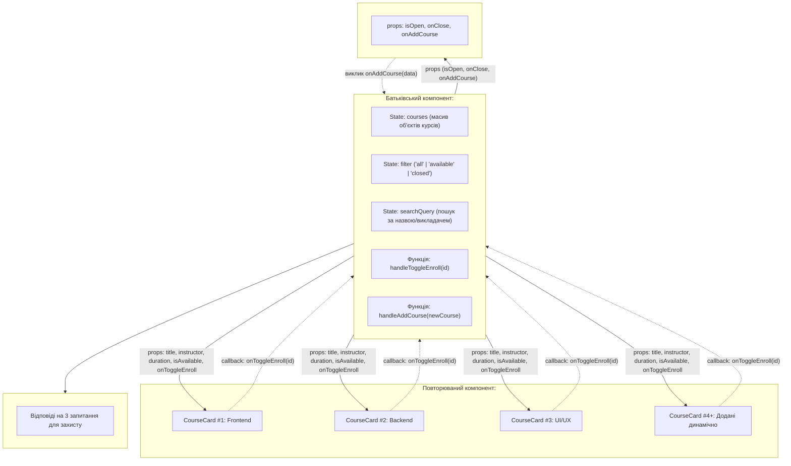

# Практична робота: React. Компоненти та властивості (props)

- **Курс:** 3  
- **Тема:** React. Компоненти та властивості (props)  
- **Завдання:** Конструктор карток навчальних курсів  
- **Максимальна оцінка:** 12 балів  

---

## 📌 Зміст
1. [Опис проєкту](#-опис-проєкту)
2. [Схема компонентів та потік даних](#-схема-компонентів-та-потік-даних)
3. [Структура даних та Props](#-структура-даних-та-props)
4. [Індивідуальне завдання (Пункт 4)](#-індивідуальне-завдання-пункт-4)
5. [Відповіді на запитання для усного захисту (Пункт 5)](#-відповіді-на-запитання-для-усного-захисту-пункт-5)
6. [Звіт про використання штучного інтелекту (ШІ)](#-звіт-про-використання-штучного-інтелекту-ші)
7. [Інструкція із запуску застосунку](#-інструкція-із-запуску-застосунку)
8. [Інструкція для публікації на GitHub](#-інструкція-для-публікації-на-github)

---

## 🚀 Опис проєкту

Застосунок розроблено на базі **React 19** та **Vite**. Він відображає інтерактивну вітрину навчальних курсів за допомогою багаторазового компонента `CourseCard`.

Кожна картка містить усі обов'язкові за завданням поля:
- **Назва курсу** (`title`)
- **Ім'я викладача** (`instructor`)
- **Тривалість курсу** (`duration`)
- **Інформація про доступність запису** (`isAvailable`)

Крім обов'язкових вимог, застосунок реалізує сучасний адаптивний дизайн (Vanilla CSS), інтерактивний запис на курс із реактивним оновленням статусу через **callback props**, фільтрацію курсів, живий пошук і можливість додавати нові картки через модальну форму.

---

## 📊 Схема компонентів та потік даних

### Mermaid-діаграма архітектури:



> 🖼️ **Графічна схема:** У корені проєкту створено файл векторної діаграми [`component-schema.svg`](./component-schema.svg), який можна переглянути у браузері або додати до звіту.

---

## 📦 Структура даних та Props

### Специфікація Props компонента `CourseCard`:

| Prop | Тип | Обов'язковий | Опис |
| :--- | :--- | :---: | :--- |
| `title` | `string` | **Так** | Назва навчального курсу |
| `instructor` | `string` | **Так** | Прізвище та ім'я викладача |
| `duration` | `string` | **Так** | Загальна тривалість навчання (тижні/години) |
| `isAvailable` | `boolean` | **Так** | Статус доступності реєстрації (`true` — відкрито, `false` — закрито) |
| `id` | `number` | Ні | Унікальний ідентифікатор курсу |
| `isEnrolled` | `boolean` | Ні | Стан запису поточного користувача на курс |
| `level` | `string` | Ні | Рівень складності (Початковий, Середній, Просунутий) |
| `icon` | `string` | Ні | Тематичний емодзі/іконка |
| `description` | `string` | Ні | Короткий опис курсу |
| `onToggleEnroll` | `function` | Ні | Callback-функція для зміни статусу реєстрації |
| `onDelete` | `function` | Ні | Callback-функція для видалення картки |

---

## 🎯 Індивідуальне завдання (Пункт 4)

Оскільки викладач надав право самостійно сформулювати та реалізувати розширену вимогу до застосунку, було впроваджено:

1. **Двостороння взаємодія через Callback Props (`onToggleEnroll`):**  
   Картка не лише відображає передані props, але й дозволяє користувачеві натиснути кнопку *"Записатися на курс"*. Це ініціює виклик функції зворотного виклику, переданої з `App`, яка оновлює стан курсу в батьківському компоненті.
2. **Фільтрація та живий пошук:**  
   Можливість миттєво відфільтрувати картки за доступністю запису (Всі / Відкриті / Закриті) або знайти потрібний курс за ключовими словами.
3. **Інтерактивне модальне вікно для додавання нового курсу:**  
   Наочна демонстрація динамічного розширення списку курсів (підготовка до запитання №3 на захисті).

---

## 💬 Відповіді на запитання для усного захисту (Пункт 5)

### 1. Чому ви створили один компонент `CourseCard`, а не три окремі компоненти?
> **Відповідь:**  
> Ми створили єдиний компонент `CourseCard` відповідно до базового принципу програмування **DRY (Don't Repeat Yourself)** та філософії компонентного підходу в React.  
> Усі три картки мають однакову розмітку (DOM-дерево), стилі та логіку взаємодії, відрізняючись лише контентом. Створення трьох окремих компонентів призвело б до трикратного дублювання коду: будь-яке виправлення верстки або додавання нової кнопки довелося б повторювати тричі. Завдяки передачі параметрів через `props`, один компонент може рендерити нескінченну кількість карток із різними даними.

### 2. Як дані потрапляють із компонента `App` до `CourseCard`?
> **Відповідь:**  
> Дані передаються завдяки **односпрямованому потоку даних (Unidirectional Data Flow)** у React зверху вниз (від батьківського компонента до дочірнього) через **властивості (props)**.  
> У компоненті `App` масив курсів ітерується за допомогою методу `.map()`. Під час кожної ітерації екземпляру `<CourseCard />` через JSX-атрибути передаються значення:  
> `<CourseCard title={course.title} instructor={course.instructor} duration={course.duration} isAvailable={course.isAvailable} />`.  
> Усередині функції `CourseCard(props)` ці значення приймаються у вигляді об'єкта аргументу, деструктуризуються та підставляються у JSX-розмітку.

### 3. Що потрібно змінити, щоб додати четвертий навчальний курс?
> **Відповідь:**  
> Оскільки рендеринг реалізовано динамічно через `courses.map(...)`, структуру коду та сам компонент `CourseCard` **змінювати не потрібно взагалі**.  
> Достатньо лише додати ще один об'єкт із необхідними полями (`title`, `instructor`, `duration`, `isAvailable`) до масиву в стані `courses`. React автоматично зафіксує зміну стану (re-render) та відмалює четверту картку на сторінці.

---

## 🤖 Звіт про використання штучного інтелекту (ШІ)

Відповідно до вимог практичної роботи, нижче наведено інформацію про використання асистента ШІ під час виконання завдання:

### 1. Для чого використовувався ШІ:
- Для структурування плану виконання роботи та розробки схеми потоку даних (props flow).
- Для консультації щодо кращих практик організації компонентів у React 19.
- Для формулювання аргументованих відповідей на теоретичні запитання для усного захисту.
- Для створення палітри кольорів та адаптивних стилів CSS.

### 2. Які рекомендації ШІ було прийнято:
- **Використання методу `Array.prototype.map()` для відмальовування списку:** Замість копіювання тегу `<CourseCard>` тричі вручну, зберегти дані у масив об'єктів. Це забезпечує чистий декларативний код і масштабованість.
- **Callback Props для інтерактивності:** Прийнято пропозицію реалізувати індивідуальне завдання через передачу функції `onToggleEnroll` як prop, що наочно демонструє зворотний зв'язок між дочірнім і батьківським компонентом.
- **Підготовка розгорнутих відповідей на запитання для захисту:** Інтеграція готового розділу з відповідями прямо в інтерфейс застосунку для зручності на заліку.

### 3. Які рекомендації ШІ було відхилено / адаптовано:
- **Відхилено використання важких CSS-бібліотек (TailwindCSS, Bootstrap):** Було вирішено писати дизайн на чистому ванільному CSS зі змінними (`CSS Variables`), оскільки для навчальної лабораторної роботи важливо продемонструвати розуміння базового CSS без зайвих залежностей.
- **Адаптовано структуру та мову інтерфейсу:** Усі назви курсів, посад викладачів, повідомлень про доступність та запитання перекладено та адаптовано відповідно до українських академічних стандартів.

---

## 🛠️ Інструкція із запуску застосунку

### Вимоги:
- Встановлений [Node.js](https://nodejs.org/) (версії 18+)

### Кроки:
1. Клонувати репозиторій або відкрити папку проєкту в терміналі.
2. Встановити залежності:
   ```bash
   npm install
   ```
3. Запустити локальний сервер для розробки:
   ```bash
   npm run dev
   ```
4. Відкрити у браузері посилання: [http://localhost:5173/](http://localhost:5173/)

---

## 📤 Інструкція для публікації на GitHub

Щоб здати посилання викладачеві:

1. Створіть новий порожній репозиторій на [GitHub](https://github.com/new) (наприклад, з назвою `react-lab-1-props`).
2. У терміналі поточної папки виконайте:
   ```bash
   git init
   git add .
   git commit -m "feat: complete React lab 1 (props and components)"
   git branch -M main
   git remote add origin https://github.com/<ВАШ_ЛОГІН_GITHUB>/react-lab-1-props.git
   git push -u origin main
   ```
3. Скопіюйте посилання на ваш репозиторій та прикріпіть до завдання.
